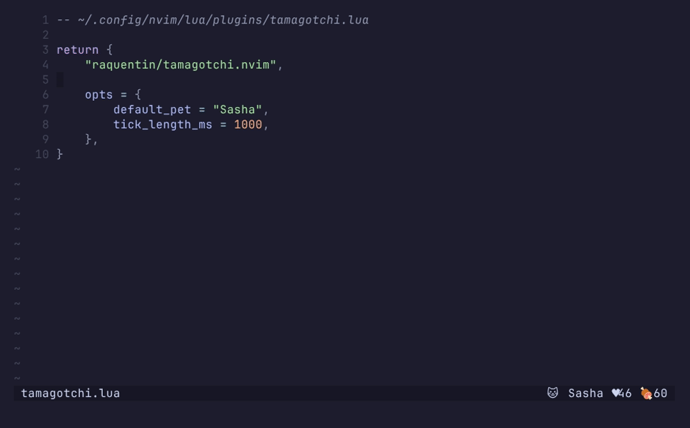

# tamagotchi.nvim

is a configurable plugin for raising pets across Neovim sessions.



## Features
- Floating Window UI: Displays your pet with sprite animations, stat bars, and a row of interaction keys.
- Customizable Behavior: Configure tick length, decay speed, and Vim events that affect your pet's mood and satiety.
- Multiple Pets: Manage a list of pets, select different ones from a menu, view more info, and reset as needed.
- Persistent State: Your pet's mood, satiety, and age persist across Neovim sessions.
- Statusline Component: Keep an eye on your pet without opening a window.
- Interactions: Feed, play with, pet, and clean your pet directly.

Requires Neovim 0.10 or newer.

## Installation

#### vim-plug

```vim
Plug "raquentin/tamagotchi.nvim"
```

#### packer.nvim

```lua
use { "raquentin/tamagotchi.nvim", }
```

#### lazy.nvim

```lua
{ "raquentin/tamagotchi.nvim", }
```

No `setup()` call is required. If you do call it, the plugin initializes
itself with defaults on `VimEnter`.

## Usage

Press `<leader>tg` to toggle the pet window, or use `:Tamagotchi`.

| command | what it does |
| --- | --- |
| `:Tamagotchi` | toggle the pet window |
| `:Tamagotchi open` / `close` | open or close it explicitly |
| `:Tamagotchi menu` | pick a different pet |
| `:Tamagotchi settings` | stats, rename, color theme, reset |
| `:Tamagotchi reset` | reset this pet, or delete every save |
| `:Tamagotchi feed` / `play` / `pet` / `clean` | interact with your pet |
| `:Tamagotchi revive` | bring back a pet that died (see [stakes](#stakes)) |
| `:checkhealth tamagotchi` | diagnose config, storage, and keymap problems |

## Configuration

```lua
require('tamagotchi').setup({
  window_toggle_keybind = "<leader>tg", -- false to bind nothing
  tick_length_ms = 1000,                -- while the window is open
  idle_tick_ms = 60000,                 -- while it is not
  default_pet = "Sasha",
  max_offline_decay_seconds = 8 * 3600, -- cap on time-away decay

  -- see "stakes" below
  stakes = false,
  sick_after_seconds = 6 * 3600,
  death_after_seconds = 24 * 3600,

  ui = {
    -- "auto" follows 'winborder' if you have set it, else rounded. Anything
    -- nvim_open_win accepts works here, including a table of glyphs.
    border = "auto",
    -- Draw bars and rules in ASCII, for fonts that render the block glyphs
    -- badly.
    ascii = false,
  },

  -- "builtin" is the animated menu with sprite previews; "native" hands the
  -- pet list to vim.ui.select, so telescope / snacks / fzf-lua users get the
  -- picker they already configured.
  picker = "builtin",

  pets = {
    {
      name = "Ilya",

      sprite_update_interval = 5,
      sprites = kitty_sprites,

      -- Tints the sprite. red, green, yellow, blue, magenta, cyan or white,
      -- and changeable per pet from the settings screen.
      color_theme = "cyan",

      initial_mood = 75,
      initial_satiety = 75,
      decay_speed = 2, -- whole number 0-6 (0=none, 6=extreme)

      vim_events = {
        {
          name = "BufWritePost",
          mood_increment = 5,
          satiety_increment = 3,
        },
        {
          name = "TextYankPost",
          mood_increment = 2,
          satiety_increment = 1,
        },
      },
    },
  },
})
```

Your pets are appended to the native ones.

Mood and satiety decay continuously with wall-clock time, whether or not Neovim
is running: `decay_speed` 1 loses 0.01 points a second, up to 0.2 at 6.
`max_offline_decay_seconds` caps how much of a single absence is charged. With
`stakes` on, time away still counts toward illness and death once a stat is at
10 or below.

Several Neovim instances can share a pet. Each save merges in whatever the
others wrote since, so feeding it in one tmux pane isn't undone by another.

## Native Pets

- **Sasha**: a cat (moderate decay, balanced)
- **Lucy**: a star and mascot of the [Gleam programming language](https://gleam.run/) (faster decay, food-focused)
- **Churro**: a dog (moderate decay, mood-focused)
- **Bunny**: a bunny (active, high satiety needs)
- **Dragon**: a dragon (slow decay, hardy)
- **Grizz**: a bear (fast decay, very hungry)
- **Po**: a panda (moderate decay, easygoing)

Each comes tinted; `s` then `c` in the pet window picks a different color, and
resetting the pet puts its default back.

## Statusline

```lua
vim.o.statusline = "%!v:lua.require'tamagotchi.statusline'.get()"
```

With lualine:

```lua
require("lualine").setup({
  sections = { lualine_x = { "tamagotchi" } },
})
```

The icons are Nerd Font glyphs. Both accept `{ ascii = true }` for a terminal
without one, and
`{ name = false }` to show only the stats. The string is rebuilt once per tick,
not on every redraw.

## Highlights

Every group is linked with `default = true`, so setting one before or after
`setup()` wins.

| group | links to | used for |
| --- | --- | --- |
| `TamagotchiNormal` / `TamagotchiBorder` | `NormalFloat` / `FloatBorder` | float body and border |
| `TamagotchiTitle` / `TamagotchiFooter` | `FloatTitle` / `FloatFooter` | border title and footer |
| `TamagotchiRule` | `FloatBorder` | inner dividers |
| `TamagotchiKey` | `Special` | the key in a `key label` pair |
| `TamagotchiMuted` | `Comment` | stat labels, separators |
| `TamagotchiSelection` | `PmenuSel` | the selected row in the pet menu |
| `TamagotchiBarHigh` / `Med` / `Low` / `Empty` | `DiagnosticOk` / `Warn` / `Error` / `NonText` | resting stat bars, by how full they are |
| `TamagotchiTrendUp` / `Down` / `Flat` | `DiagnosticOk` / `DiagnosticError` / `NonText` | a stat that just moved, and the `·` marker for one that has not |
| `TamagotchiSick` / `TamagotchiDead` | `DiagnosticWarn` / `Comment` | health state in the title |
| `TamagotchiColor*` | assorted | per-pet sprite color themes |

## Stakes

Off by default. With `stakes = true`, a pet left at rock-bottom mood or satiety
gets sick after `sick_after_seconds` and dies after `death_after_seconds`. A
dead pet stops decaying, shows a tombstone, and can be brought back with
`:Tamagotchi revive`. Choosing "start new life" in the pet menu archives it to
`graveyard/` rather than deleting it.

## Data

Pets live in `stdpath("data")/tamagotchi/`:

```
state.json         which pet was active last
pets/<name>.json   one file per pet
graveyard/         archived pets
```

Which pet loads at startup is whichever you used last, not `default_pet` —
`default_pet` only decides where you begin. Save files from before this layout
(`stdpath("data")/tamagotchi_<name>.json`) are migrated automatically on first
run and left in place; once you've confirmed everything came across, they can be
deleted.

## Contributing

```sh
nix develop     # neovim, stylua, luacheck, busted
make ci         # exactly what CI runs
```

`make test` runs the specs in headless Neovim; `make format` applies stylua.
`doc/tamagotchi.txt` is generated from this README by CI — don't edit it by hand.

`make demo` re-records `media/demo.gif` with [vhs](https://github.com/charmbracelet/vhs)
from `scripts/demo.tape`. It runs against a throwaway `XDG_DATA_HOME` and a
seeded pet, so it never touches your own save and every run comes out the same.

Submit issues and PRs as you please. If you have a more general question, start a [discussion](https://github.com/raquentin/tamagotchi.nvim/discussions).
